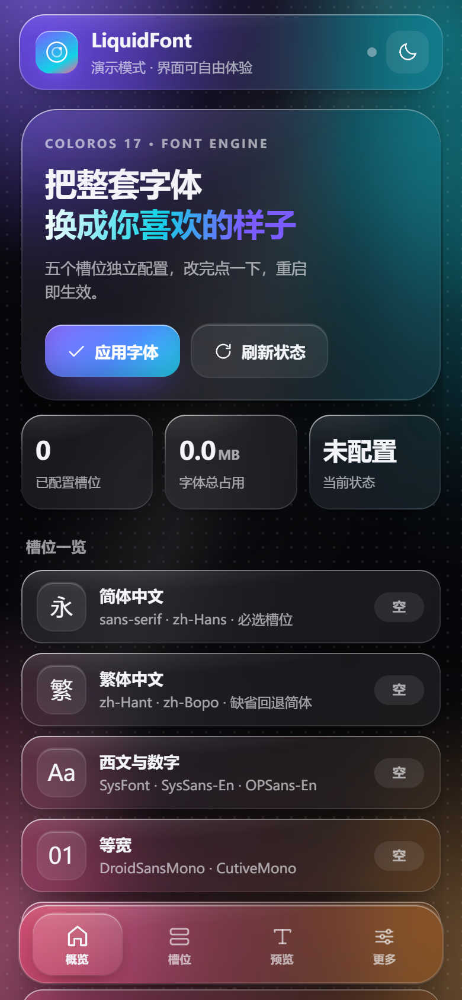
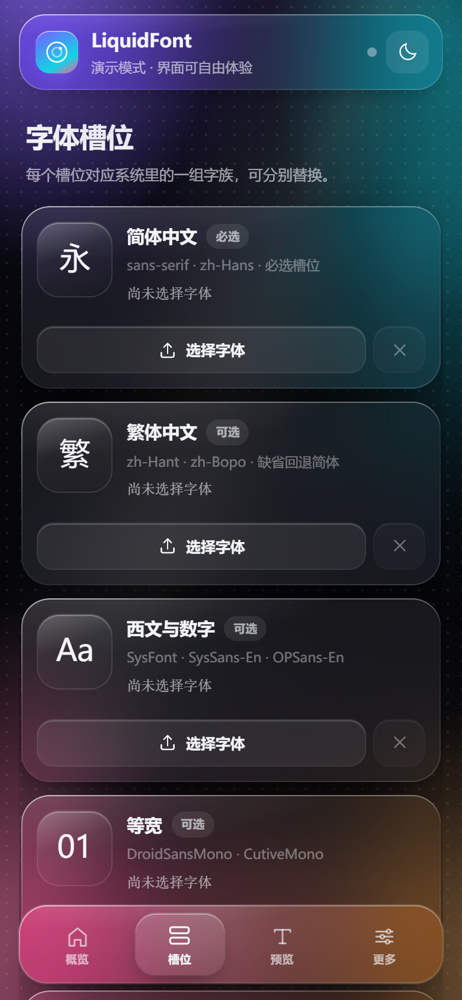
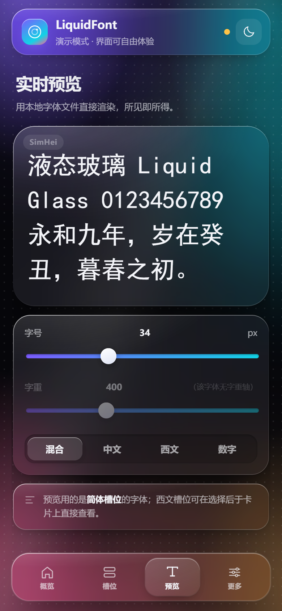
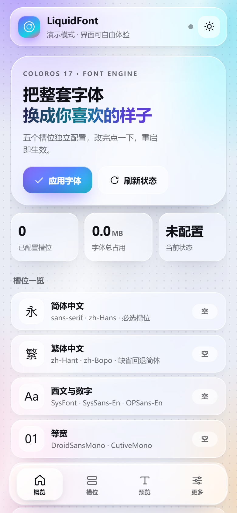

# LiquidFont

[](https://github.com/872446136-source/LiquidFont/releases)
[](LICENSE)
[](https://github.com/872446136-source/LiquidFont)

> ColorOS 16 / 17 字体替换模块 · 五槽位独立配置 · 全液态玻璃 WebUI

LiquidFont 把「换字体」这件事做成了一件顺手的事：把 `.ttf` / `.otf` 丢进 WebUI，
选好槽位，点一下应用，重启。没有命令行，没有编辑器，也不用记 fonts.xml 里那些字族名。



| 槽位 | 实时预览 | 浅色主题 |
| --- | --- | --- |
|  |  |  |

## 特性

- **五个槽位，各管各的** — 简体 / 繁体 / 西文 / 等宽 / Emoji，互不牵连；缺省自动回退。
- **全液态玻璃 WebUI** — 网格渐变 + 流动极光 + 镜面高光的玻璃拟态，深色 / 浅色双主题，
  底栏液态指示器、指针透镜、涟漪与弹性反馈，全部纯 CSS + 原生 JS，零构建、零依赖。
- **选字体前先看效果** — 直接用你选的字体文件在页面里渲染，字号 / 字重可拖；
  顺便读出家族名、字重轴、字形数与中文 / 西文覆盖量。
- **ColorOS 17 的完整映射** — 除 `SysFont-Regular` / `SysSans-En` 外，还覆盖 ColorOS 17
  新增的 `OPSans-En`，避免某些界面英文没换干净。
- **内置全字库兜底** — 打包了遍黑体（CJK 扩展 B–J 全汉字）与 GNU Unifont 18.0.01
  （整张 Unicode 码表），主字体没覆盖的生僻字、冷门文字不会再变成豆腐块；可在 WebUI 里一键关掉。
- **Play 商店也不放过** — 停用 Google Play 服务的可下载字体链路并清缓存，
  Play 商店 / Chrome / Gmail 的英文和数字才会真正跟着换（这几家原本绕开 `system/fonts`）。
- **安全** — 只做 overlay 挂载，删除模块即完整还原；提供一键还原与日志查看。

| 槽位 | 作用 | 目标文件 |
| --- | --- | --- |
| `hans.ttf` | 简体中文（必选） | `SysSans-Hans-Regular` `SysFont-Hans-Regular` `SysFont-Static-Regular` `SysFont-Myanmar` |
| `hant.ttf` | 繁体中文（可选） | `SysSans-Hant-Regular` `SysFont-Hant-Regular` |
| `en.ttf` | 西文与数字（可选） | `SysFont-Regular` `SysSans-En-Regular` `OPSans-En-Regular` `Roboto-Regular` |
| `mono.ttf` | 等宽（可选） | `DroidSansMono` `CutiveMono` |
| `emoji.ttf` | Emoji（可选） | `NotoColorEmoji` `NotoColorEmoji1`（其余留作缺字回退） |

### 内置全字库（随包附带，不用选）

| 字库 | 版本 | 落点 | 作用 |
| --- | --- | --- | --- |
| 遍黑体 Plangothic P1 / P2 | 2.9.5795 | `PlangothicP1.ttf` `PlangothicP2.ttf` | CJK 扩展 B–J 全部汉字，顶替系统里的旧版本 |
| GNU Unifont / Unifont Upper | 18.0.01 | `LiquidFont-Unifont.otf` `LiquidFont-UnifontUpper.otf` | 整张 Unicode 码表（含 Plane 1–16），排在兜底链最后 |

两个 Unifont 字族是**追加**到 `fonts.xml` 末尾的，排在所有系统字体之后——只接管前面没人认领的码位，
不会抢走遍黑体、NotoColorEmoji 已经覆盖的字形。

## 安装

1. 下载 Release 里的 `LiquidFont-v*.zip`；
2. 在 Magisk / KernelSU / SukiSU 里刷入；
3. 重启，打开模块的 WebUI（KernelSU 系自带；Magisk 需 WebUI X 或 KsuWebUI Standalone）；
4. 在「槽位」页选好字体 → 「应用字体」→ 再重启一次。

> 设置里保持「系统默认字体」就行，不用特意切到 Roboto。ColorOS 的 `sans-serif` 首位是
> `SysFont-Regular.ttf`（OPPO Sans 可变字体），而且配置里有 `<alias name="Roboto" to="sans-serif"/>`——
> 连显式请求 Roboto 的应用都会被导到这条链上。模块已覆盖 `sans-serif` / `sys-sans-en` /
> `op-sans-en` / `Roboto-Regular` 四条西文路径，切不切字体都一样。

### 环境要求

- ColorOS 16 / 17（其它系统能装，但 fonts.xml 的字族可能对不上，会出现缺字）
- Magisk 20.4+ / KernelSU（KernelSU 3.0+ 需要元模块：mountify / hybrid_mount）
- 字体格式：`.ttf` / `.otf`，单个文件建议 ≤ 30 MB

## 使用说明

- **必须先配简体**，其它槽位都可以空着；空着时会回退到简体（等宽 / Emoji 空着则保留系统默认）。
- **西文槽位不要选带汉字的字体**。`fonts.xml` 里 `sans-serif` 排在 `zh-Hans` 之前，
  西文字体自带的汉字会盖掉中文字体。WebUI 会读 cmap 检测并在卡片上给出 ⚠ 提示。
  若确实要用（例如思源黑体全家桶），把 `hb-subset` 编译成 `tools/subset` 放进模块，
  `apply.sh` 会自动裁掉西文槽位的 CJK 字形（见 `tools/README.md`）。
- 应用字体后必须**重启**，字体是开机时被系统读进缓存的。
- 全字库兜底默认开启。关掉后重启即恢复系统原样；它不会覆盖你自己选的五槽位字体，
  只影响主字体没覆盖到的字符。
- **Play 商店 / Chrome / Gmail 的英文数字没变？** 这几家的字体走 Google Play 服务的
  「可下载字体」，绕开 `system/fonts`，所以换系统字体对它们无效。去「更多」页打开
  **Play 商店字体接管**：它会停用 `FontsProvider` 与 `UpdateSchedulerService`、
  清掉已下载的字体缓存，然后重启相关应用即可。默认关闭，需要时再开。
- 不同 ColorOS 版本的字体清单略有差异，`apply.sh` 只会写设备上真实存在的文件，
  不会往模块里塞用不上的副本。

## 目录结构

```
LiquidFont/
├── module.prop                 # 模块信息
├── customize.sh                # 刷入脚本：环境检查 / 继承旧字体 / 补齐派生 XML
├── apply.sh                    # 应用脚本：五槽位 → system/fonts（WebUI 也调用它）
├── gms.sh                      # Play 商店字体接管：停用 GMS 字体服务 + 清缓存
├── uninstall.sh                # 卸载清理
├── FONTS/                      # 槽位目录（hans/hant/en/mono/emoji.ttf）
├── FALLBACK/                   # 内置全字库（遍黑体 / Unifont + 各自许可证）
├── system/
│   ├── etc/fonts.xml           # ColorOS 17 主字体配置
│   └── system_ext/etc/
│       ├── fonts_base.xml      # 派生配置
│       └── fonts_ule.xml       # 派生配置（ULE）
├── webroot/                    # WebUI（KernelSU 规范目录）
│   ├── index.html
│   └── assets/{style.css,app.js,bridge.js,fontinfo.js}
├── tools/                      # 可选原生工具（subset）
├── dev/shot.mjs                # 开发用：CDP 截图 / 量尺寸
└── build.py                    # 打包成可刷入 zip
```

## 构建

```bash
python build.py            # 产出 dist/LiquidFont-v1.0.0.zip
python build.py --no-zip   # 只做检查
```

打包不需要 Node、不需要 NDK，只需要 Python 3。CI 见 `.github/workflows/release.yml`。

## 实现说明

- **为什么改 4 份 XML**：ColorOS 17 的字体由 `system/etc/fonts.xml` 与
  `system/system_ext/etc/fonts_{base,ule}.xml` 共同决定，只改一份会出现「设置里变了、
  桌面没变」。模块直接带上这 4 份（`font_fallback.xml` 刷入时从设备复制，没有就用主配置兜底）。
- **为什么用 overlay 而不是替换**：模块目录里的 `system/fonts/*.ttf` 由管理器挂载到
  真实路径，模块停用 / 卸载后挂载消失，系统字体自动回来，没有「刷坏回不去」的风险。
- **全字库为什么要改 fonts.xml**：Unifont 是全新字库，系统里没有它的位置，只能在 `familyset`
  末尾追加两个字族。追加在最后是刻意的——Android 按声明顺序找字，排最后意味着只有前面
  所有字体都不认识的码位才会轮到它，属于纯增量，不会改变已有字形的渲染。
- **为什么 Play 商店要单独处理**：GMS 的 `FontsProvider` 通过 Downloadable Fonts 直接把
  字体喂给应用，进程里的字体上下文和系统字体是两套。所以光改 `system/fonts` 没用，
  必须把这个提供器停掉，再清掉 `/data/fonts` 等缓存，应用才会回落到系统字体。
- **WebUI 怎么把文件写进去**：KernelSU 只给了 `ksu.exec`，没有文件 API。所以前端把字体
  base64 分块（64 KB/块，避开 argv 128 KB 上限）用 `printf | base64 -d >>` 追加写，
  最后用 `wc -c` 校验字节数，不一致就报错。

## 已知限制

- 没有内置 Zygisk 字体预加载。被 DenyList / 隐藏应用列表「卸载」掉模块的应用，
  可能读不到字体而回退默认字体（FontMM 用原生 warmUpCache 解决，本模块暂未实现）。
- 不做可变字体 `wght` 轴重写。字体自带的字重轴如果与系统的 100–900 对不上，
  表现是粗细层次不自然，需要在字体侧处理。
- 开启「Play 商店字体接管」后，依赖 Google 可下载字体的应用会回落到系统字体；
  少数把字体当资源的应用可能需要重新打开一次。关掉开关即可恢复原状。

## 致谢

- [FontMM](https://github.com/YuleBest/FontMM) — 五槽位思路与 ColorOS 字体配置的先行者。
- [遍黑体 Plangothic](https://github.com/Fitzgerald-Porthmouth-Koenigsegg/Plangothic_Project) —
  基于思源黑体、以中国大陆字形标准补全 CJK 扩展区，MIT / 思源黑体 OFL-1.1。
- [GNU Unifont](https://unifoundry.com/unifont/) — Roman Czyborra、Paul Hardy 等人维护的
  全 Unicode 覆盖点阵字库，OFL-1.1 + GPL-2.0-or-later（字体嵌入例外）。
- 字体配置文件来自 ColorOS 17 系统镜像，版权归 OPPO / 各字体厂商所有，仅供个人折腾使用。

## 许可

模块代码以 [GPL-3.0](LICENSE) 发布。

`FALLBACK/` 里的两套字库按各自原许可分发，许可证原文随包附带：

- `FALLBACK/LICENSE-Plangothic.txt` — 遍黑体，MIT（字体衍生自思源黑体，SIL OFL 1.1）
- `FALLBACK/LICENSE-Unifont.txt` — GNU Unifont，SIL OFL 1.1 + GPL-2.0-or-later（含字体嵌入例外）

`FONTS/` 下的五个槽位始终留空，用户自己放入的字体不随仓库分发。
